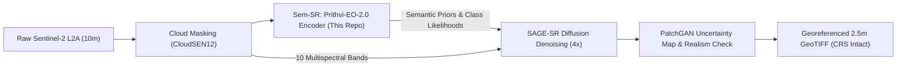
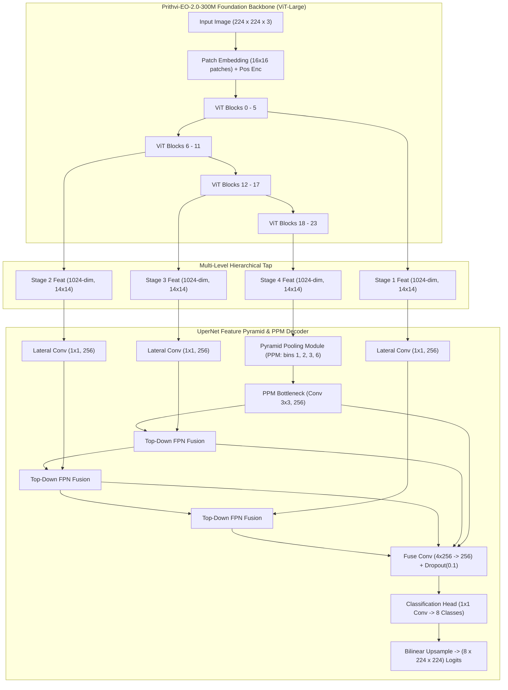
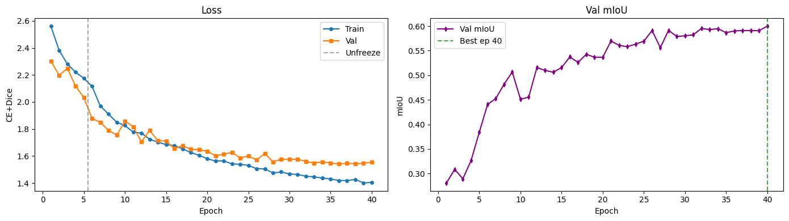
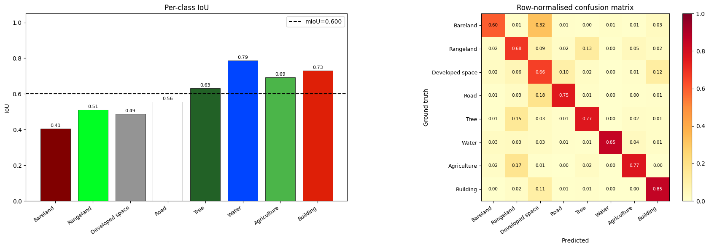
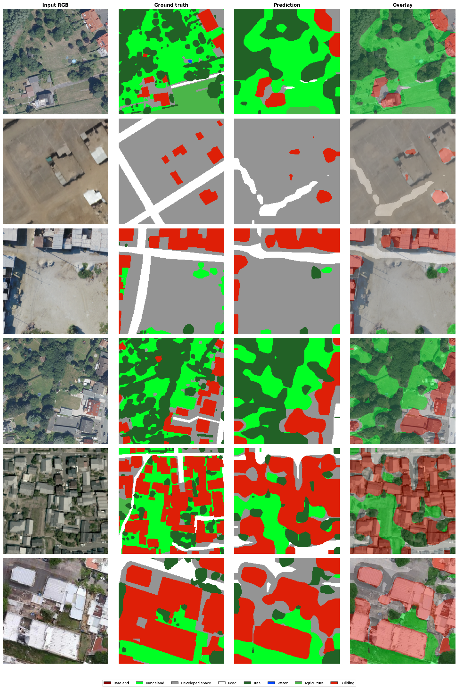
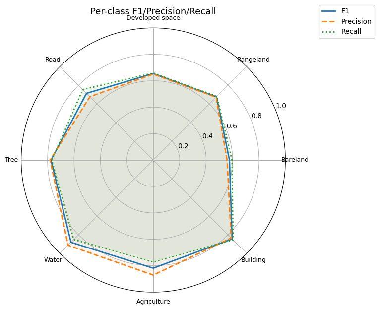

# Sem-SR: Semantic Prior Encoder via Fine-Tuned Prithvi-EO-2.0 on OpenEarthMap

[](https://www.sih.gov.in/)
[](#smart-india-hackathon-2026--problem-statement-context)
[](#smart-india-hackathon-2026--problem-statement-context)
[](https://huggingface.co/ibm-nasa-geospatial/Prithvi-EO-2.0-300M)
[](https://open-earth-map.org/)
[](LICENSE)

---

## 📌 Smart India Hackathon 2026 — Problem Statement Context

| Parameter | Details |
| :--- | :--- |
| **Problem Statement ID** | **SIH26142** |
| **Problem Statement Title** | **Deep Learning Based Super Resolution Mapping (SRM) from Medium Resolution Satellite Imageries** |
| **Theme** | **Space Technology** |
| **Category** | Software |
| **Team ID** | **191393** |
| **Team Name** | **ThunderBoltz** |
| **Core Solution** | **GISMO: Semantic-Aware Diffusion Super-Resolution Pipeline** |

---

## 🛰️ Role of `Sem-SR` in the End-to-End GISMO Pipeline

In standard Single Image Super-Resolution (SISR) algorithms, upscaling 10m Sentinel-2 multispectral bands to 2.5m high-resolution representations often produces hallucinated textures, blurry object boundaries, and spectral distortion. 

**`Sem-SR`** solves this by acting as the **Semantic Prior Encoder** within GISMO's unified diffusion framework:
1. **Observe**: Ingests raw Copernicus Sentinel-2 Level-2A surface reflectance tiles (after automated cloud/shadow masking via CloudSEN12).
2. **Understand (`Sem-SR` - This Repository)**: Feeds tiles through our fine-tuned foundation vision backbone (**Prithvi-EO-2.0-300M + UperNet decoder**) to extract land-cover class likelihoods and sharp geometric segment boundaries across 8 canonical land-cover classes.
3. **Reconstruct (SAGE-SR Diffusion)**: Injects these semantic class probabilities and structural priors directly into the reverse-diffusion denoising schedule to guide the reconstruction of 10 multispectral bands from 10m to 2.5m (4× upscaling).
4. **Verify & Export**: Uses PatchGAN adversarial refinement to map localized uncertainty and exports georeferenced GeoTIFFs retaining native Coordinate Reference Systems (CRS) for immediate analysis in QGIS and ArcGIS.



---

## 🧠 Model Architecture & Technical Details

`Sem-SR` adapts NASA and IBM's geospatial foundation model **Prithvi-EO-2.0-300M** for high-resolution semantic boundary guidance using a multi-scale feature pyramid decoder.



### 1. Vision Transformer Backbone
- **Pretrained Foundation**: `ibm-nasa-geospatial/Prithvi-EO-2.0-300M` Masked Autoencoder (MAE) weights.
- **Architecture**: `vit_large_patch16_224` (`embed_dim=1024`, `depth=24`, `num_heads=16`, `patch_size=16×16`).
- **Channel Adaptation**: Adapted 3D spatio-temporal projection layers to 2D 3-channel optical inputs, interpolating 2D position embeddings for custom patch sizes.
- **Hierarchical Feature Extraction**: Tapped hidden states at depths `[5, 11, 17, 23]` to capture low-level textural boundaries up to high-level land-cover semantics.

### 2. Multi-Level UperNet Decoder
- **Pyramid Pooling Module (PPM)**: Adaptive average pooling with bin sizes `(1, 2, 3, 6)` applied to Stage 4 features to capture global geographic context.
- **Feature Pyramid Network (FPN)**: Lateral projections to `fpn_dim = 256` with top-down additive fusion.
- **Multi-Level Fusion**: Concatenates all 4 upsampled stages followed by `Conv2D(1024, 256) -> BatchNorm -> ReLU -> Dropout(0.1) -> Conv2D(256, 8, kernel_size=1)`.

---

## 🔬 Learning Technique & Training Strategy

Fine-tuning a 300M-parameter foundation vision model on dense remote sensing imagery requires disciplined regularization to prevent catastrophic forgetting and mitigate extreme class imbalance.

### 1. Two-Stage Transfer Learning Schedule
- **Stage 1 — Linear Probing / Warmup (Epochs 1–5)**:
  - Backbone parameters **FROZEN** (all 24 ViT blocks locked).
  - Only the UperNet decoder and segmentation head are trained at learning rate `η = 1e-3`.
  - Stabilizes the randomly initialized projection heads without disturbing foundation feature spaces.
- **Stage 2 — End-to-End Fine-Tuning (Epochs 6–40)**:
  - Backbone **UNFROZEN** (total trainable parameters: **337,137,416**).
  - Differential learning rates applied:
    - Backbone LR: `η_backbone = 2e-5` (low learning rate to preserve foundation priors).
    - Decoder LR: `η_decoder = 1e-3` decaying with a Cosine Annealing schedule down to `1e-6`.
  - Optimizer: **AdamW** (`weight_decay = 1e-2`).
  - Mixed Precision: PyTorch `torch.amp.autocast('cuda')` (FP16).

### 2. Composite Class-Weighted Loss Function
To address class imbalance (e.g., Water at 3.04% and Bareland at 2.07% vs. Rangeland at 21.90%), we formulate a composite loss combining **Label-Smoothed Weighted Cross-Entropy** and **Multi-Class Soft Dice Loss**:

$$\mathcal{L}_{\text{total}} = \mathcal{L}_{\text{CE-Smooth}}(y, \hat{y}; w) + \mathcal{L}_{\text{Dice}}(y, \hat{y})$$

$$\mathcal{L}_{\text{Dice}} = 1 - \frac{1}{C}\sum_{c=1}^{C}\frac{2 \sum_i p_{i,c} g_{i,c} + \epsilon}{\sum_i p_{i,c} + \sum_i g_{i,c} + \epsilon}$$

Where inverse square-root class frequency weights $w_c = \frac{1}{\sqrt{f_c + \epsilon}}$ normalize penalty distributions across rare classes:
- **Bareland**: 1.943
- **Water**: 1.604
- **Road**: 1.041
- **Agriculture**: 0.849
- **Building**: 0.686
- **Developed space**: 0.648
- **Tree**: 0.630
- **Rangeland**: 0.598

---

## 📊 Dataset: OpenEarthMap (OEM) Benchmark

Training was conducted on the high-resolution **OpenEarthMap (OEM)** benchmark dataset (0.25m – 0.5m sub-meter aerial/satellite imagery across worldwide geographic regions).

- **Training Split**: 2,149 verified image-label pairs.
- **Validation Split**: 538 verified image-label pairs.
- **Input Channels**: Normalized RGB tiles sampled at $224 \times 224$.
- **Dataset Channel Means (R, G, B)**: `[118.535, 121.595, 106.707]`
- **Dataset Channel Stds (R, G, B)**: `[50.937, 46.308, 48.135]`
- **Label Resolution**: 8 standardized classes (class `0` unlabelled/no-data ignored via `ignore_index = 255`).

| Class ID | Land-Cover Class Name | Pixel Frequency (%) | Computed Loss Weight |
| :---: | :--- | :---: | :---: |
| 0 | Bareland | 2.07% | 1.943 |
| 1 | Rangeland | 21.90% | 0.598 |
| 2 | Developed space | 18.61% | 0.648 |
| 3 | Road | 7.22% | 1.041 |
| 4 | Tree | 19.69% | 0.630 |
| 5 | Water | 3.04% | 1.604 |
| 6 | Agriculture | 10.85% | 0.849 |
| 7 | Building | 16.61% | 0.686 |

---

## 📈 Quantitative Evaluation & Metrics

The checkpoint achieving the highest validation Mean Intersection over Union (**mIoU = 0.5999**) was evaluated over the complete held-out validation benchmark.

### Overall Benchmark Performance
- **Overall Pixel Accuracy**: **74.37%**
- **Mean Intersection over Union (mIoU)**: **59.99%**
- **Mean F1 Score**: **74.24%**

### Class-Wise Quantitative Breakdown

| Class Name | IoU (Intersection over Union) | F1 Score / Dice Coefficient | Performance Characterization |
| :--- | :---: | :---: | :--- |
| **Water** | **0.7866** | **0.8805** | Outstanding spectral distinctiveness |
| **Building** | **0.7304** | **0.8442** | Sharp footprint boundary segmentation |
| **Agriculture** | **0.6927** | **0.8184** | High structural pattern retention |
| **Tree** | **0.6311** | **0.7739** | Accurate canopy clustering |
| **Road** | **0.5555** | **0.7143** | Continuous corridor detection |
| **Rangeland** | **0.5111** | **0.6765** | Robust vegetative ground separation |
| **Developed space** | **0.4866** | **0.6547** | Accurate mixed urban surface labeling |
| **Bareland** | **0.4055** | **0.5770** | Hardest class due to high spectral overlap with dry soil |

---

## 🖼️ Inferred Outputs & Visualizations

### 1. Training Convergence & Optimization Dynamics
Training and validation curves over 40 epochs illustrating loss reduction and continuous validation mIoU progression through linear warmup and full unfreezing:



### 2. Metrics Distribution & Per-Class Performance
Per-class IoU bar charts and F1-score comparisons demonstrating strong discrimination across structured classes:



### 3. Qualitative Segmentation Outputs
Ground-truth vs. model prediction comparisons on held-out validation scenes, demonstrating fine delineation of buildings, road networks, and natural water bodies:



### 4. Balanced Radar Performance Profile
Polar radar chart comparing IoU and F1 scores across all 8 land-cover classes:



---

## 🚀 Running the Notebook

### Prerequisites
- GPU: Single NVIDIA T4, P100, V100, or A100 GPU (minimum 15GB VRAM).
- Python 3.10+
- PyTorch 2.0+ with CUDA support

### Environment Setup
```bash
git clone git@github.com:kshrs/sem-sr.git
cd sem-sr
pip install torch torchvision timm einops huggingface_hub rasterio albumentations matplotlib tqdm
```

### Execution
Open and run the notebook:
```bash
jupyter notebook prithvi-eo-oem-fine-tune-model.ipynb
```

The notebook:
1. Downloads foundation model weights from Hugging Face Hub (`ibm-nasa-geospatial/Prithvi-EO-2.0-300M`).
2. Configures data loaders with exact RGB channel statistics and inverse-frequency weighting.
3. Trains Stage 1 (frozen backbone) and Stage 2 (unfrozen backbone with cosine schedule).
4. Saves checkpoints to `checkpoints/best.pt` and evaluates full NumPy confusion matrices.

---

## 🔗 Related Repositories in the GISMO Solution

- **GISMO Core Web Platform**: [github.com/kshrs/gismo](https://github.com/kshrs/gismo)
- **Pre-Processing & Cloud Removal**: [github.com/NVSSADVIK/Preprocessing-Pipeline](https://github.com/NVSSADVIK/Preprocessing-Pipeline)
- **Sem-SR (This Repository)**: [github.com/kshrs/sem-sr](https://github.com/kshrs/sem-sr)
- **SAGE-SR Diffusion Core**: [github.com/barath37/sage-sr](https://github.com/barath37/sage-sr)
- **Adversarial Post-Processing & Uncertainty**: [github.com/ashb5599/GISMO-Adversarial](https://github.com/ashb5599/GISMO-Adversarial)
- **Video Walkthrough & Demonstration**: [youtu.be/4ZCl6-L0mTY](https://youtu.be/4ZCl6-L0mTY)

---

## 👥 Team & Submission Acknowledgements

Submitted as part of the **Smart India Hackathon (SIH) 2026** under Problem Statement **SIH26142**.

**Team Name:** **ThunderBoltz**  
**Team ID:** **191393**  
**Theme:** Space Technology  
